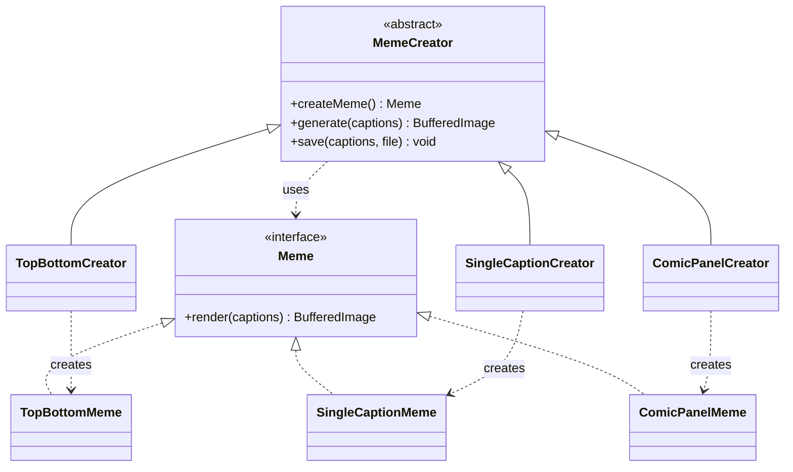

# Simple project explanation

## Main idea

EN: The program creates PNG memes. A creator chooses which meme object to create. The common workflow renders and saves it.

RU: Программа создаёт PNG-мемы. Создатель определяет, какой объект мема создать. Общий процесс рисует и сохраняет изображение.

## Classes

| Class | English | Русский |
| --- | --- | --- |
| Meme | Product interface | Общий интерфейс продукта |
| MemeCreator | Abstract creator and common workflow | Абстрактный создатель и общий процесс |
| TopBottomCreator | Creates TopBottomMeme | Создаёт TopBottomMeme |
| SingleCaptionCreator | Creates SingleCaptionMeme | Создаёт SingleCaptionMeme |
| ComicPanelCreator | Creates ComicPanelMeme | Создаёт ComicPanelMeme |
| TopBottomMeme | Renders top and bottom captions | Рисует подписи сверху и снизу |
| SingleCaptionMeme | Renders one caption | Рисует одну подпись |
| ComicPanelMeme | Renders two comic panels | Рисует две панели комикса |
| MemeDrawing | Shared drawing and text validation | Общее рисование и проверка текста |
| Main | Reads input and selects a creator | Принимает ввод и выбирает создателя |

SimpleTests is a separate test class, outside the 10 application classes. / SimpleTests — отдельный тестовый класс, не входящий в 10 классов приложения.

## Where the factory method is

```java
public abstract class MemeCreator {
    public abstract Meme createMeme();

    public BufferedImage generate(List<String> captions) {
        Meme meme = createMeme();
        return meme.render(captions);
    }
}
```

EN: createMeme is the Factory Method. Each subclass overrides it. generate does not know the concrete meme class.

RU: createMeme — фабричный метод. Каждый подкласс переопределяет его. generate не знает конкретный класс мема.

```java
public class SingleCaptionCreator extends MemeCreator {
    @Override
    public Meme createMeme() {
        return new SingleCaptionMeme();
    }
}
```

EN: This creator returns a SingleCaptionMeme. Another creator returns another product through the same interface.

RU: Этот создатель возвращает SingleCaptionMeme. Другой создатель возвращает другой продукт через тот же интерфейс.

## Execution example

```java
MemeCreator creator = new SingleCaptionCreator();
creator.save(List.of("IT WORKED ON MY COMPUTER"),
        Path.of("output/example.png"));
```

1. save calls generate. / save вызывает generate.
2. generate calls createMeme. / generate вызывает createMeme.
3. SingleCaptionCreator returns SingleCaptionMeme. / Создатель возвращает продукт.
4. render validates and draws the caption. / render проверяет и рисует подпись.
5. save writes the completed PNG. / save сохраняет готовый PNG.

## Easy text validation

EN: Every caption uses a 28 px font. The program measures real word widths. If a line is full, the next word moves to a new line. If a word is too wide or the total height is too large, it throws IllegalArgumentException. Visible glyph bounds are checked too.

RU: Каждая подпись использует шрифт 28 пикселей. Программа измеряет настоящую ширину слов. Если строка заполнена, следующее слово переносится. Если слово слишком широкое или общая высота слишком большая, выбрасывается IllegalArgumentException. Также проверяются видимые границы символов.

EN: Font shrinking is unnecessary for the task because rejecting oversized text is also allowed.

RU: Уменьшать шрифт необязательно: по условию слишком длинный текст также разрешается отклонять.

## Add the third format during defence

The finished project includes the third format. During rehearsal, show the first two formats first, then explain these additions.

Готовый проект уже содержит третий формат. Для репетиции сначала покажи первые два, затем объясни следующие добавления.

1. Add ComicPanelMeme implements Meme. Its render method validates two captions and draws two panels. / Добавь продукт ComicPanelMeme implements Meme.
2. Add ComicPanelCreator extends MemeCreator. / Добавь создателя ComicPanelCreator extends MemeCreator.

```java
@Override
public Meme createMeme() {
    return new ComicPanelMeme();
}
```

3. Use the existing workflow:

```java
MemeCreator creator = new ComicPanelCreator();
creator.save(List.of("BEFORE", "AFTER"), Path.of("output/comic.png"));
```

4. The original TopBottom and SingleCaption classes do not change. / Старые классы форматов не меняются.
5. To show a new menu option, add the creator selection to Main. This is application setup, not a change to the old format classes. / Для нового пункта меню добавь выбор создателя в Main. Это настройка приложения, а не изменение старых форматов.

## Defence speech in simple English

My project uses Factory Method. Meme is the product interface. MemeCreator is the abstract creator. Its factory method is createMeme. Each concrete creator makes one meme format.

My program has three formats: top and bottom text, one caption, and a comic panel. It measures text before drawing. It wraps words and rejects text that cannot fit. This prevents overflow.

To add the comic format, I added one product and one creator. I did not change the existing format classes. This supports the Open Closed Principle.

## Перевод речи

Мой проект использует Factory Method. Meme — интерфейс продукта. MemeCreator — абстрактный создатель. Его фабричный метод — createMeme. Каждый конкретный создатель создаёт свой формат мема.

Программа имеет три формата: текст сверху и снизу, одну подпись и комикс. Она измеряет текст перед рисованием, переносит слова и отклоняет текст, который не помещается. Это предотвращает переполнение.

Для формата комикса я добавил один продукт и одного создателя. Старые классы форматов не изменились. Это поддерживает принцип открытости и закрытости.

## Useful questions

**Where is inheritance?** Concrete creators extend MemeCreator. / Создатели наследуются от MemeCreator.

**Where is implements?** Products implement Meme. / Продукты реализуют интерфейс Meme.

**Why not Abstract Factory?** We create one product type, Meme, rather than a family of different product types. / Мы создаём один тип продукта, а не семейство разных типов.

**Why does Main contain if/else?** Main selects which creator to use. Product creation remains in the overridden factory methods. / Main выбирает создателя. Создание продукта остаётся в переопределённых фабричных методах.

**Where do I change the font?** In MemeDrawing.caption, at new Font("SansSerif", Font.BOLD, 28). The layout is measured again with the new font. / Размер шрифта меняется в MemeDrawing.caption. После изменения размеры текста снова измеряются.

**Where do I change the caption area?** In the Rectangle arguments in the selected product's render method. / Область подписи меняется в Rectangle внутри render нужного продукта.

## UML


